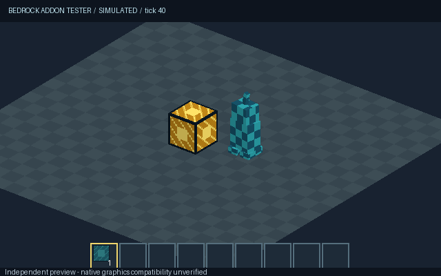
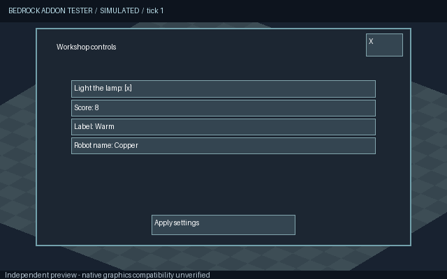

# Bedrock Addon Tester

**An independent add-on simulator that an AI assistant can operate. No Minecraft installation, Bedrock server, Microsoft login, or AI API key is required.**

The assistant you already use supplies the reasoning. This program loads your add-on, simulates supported behavior, renders pack assets, accepts virtual controls, and returns evidence through MCP or a command line.

**Version 0.4 improves the emulator's execution rules, rendering and animation, but is not a complete Bedrock implementation.** It does not establish 95% or 100% compatibility with Minecraft. It cannot fully test arbitrary add-ons, native graphics, or native menus yet. Unsupported features appear in reports; `simulation_passed` applies only to assertions in the implemented model. Native compatibility remains `unverified`.

This release corrects early/before-event script access, manifest import checks, Molang control flow, animation clocks and stop/hold behavior, and geometry crossing the camera's near plane. Entity render controllers now choose geometry, textures, materials, visibility and tint. The scanner checks nested fields and unexecuted animation branches. A new [conformance tool](docs/CONFORMANCE.md) checks 50 explicit documented contracts: **47 match; 3 remain unsupported**. These selected, project-authored cases do not measure native Minecraft accuracy.



## What is implemented

| Area | Simulator behavior | Important boundary |
| --- | --- | --- |
| Packs | Folders, ZIP, `.mcpack`, nested `.mcaddon`, inline files; bounded archive handling and content hashes | Not a complete official schema validator |
| Blocks | States, Molang permutations, materials, placement/breaking, continuous AABB sweeps, separate ray selection boxes, scheduled custom ticks | No redstone, fluids, native mining timing, or world generation |
| Entities | Spawn, health/damage events, tags, filtered queries, effects subset, component groups and filtered events, properties, seeded choices, gravity | No general mob AI, armor/invulnerability simulation, or full native combat |
| Items and recipes | 36-slot player inventory, stacking, metadata, names/lore, durability data, entity containers, transfers, shaped/shapeless crafting and overflow rollback | No equipment/enchantments, automatic durability wear, hunger or food consumption |
| Scripts | Isolated QuickJS; bundled ES modules, classes, async/await, generator jobs, `waitTicks`; selected APIs/hooks; v2 early/restricted/default phases; declared-import checks | API subset; exact native timing and all method/version privileges unverified; dynamic compilation/external imports unsupported |
| Commands and scores | Bounded command interpreter, selected selectors, objectives, named/entity participants and integer scores | Only documented command subset; no operating-system command execution |
| Graphics | Textured cuboids, bones/UVs, near-plane clipping; render-controller resource arrays, materials, visibility/tint; per-instance animation clocks, linear keyframes, rotation/position cross-fades | Independent software preview; no RenderDragon, PBR, native lighting, GPU parity, Catmull–Rom, or scale cross-fades |
| Controls and menus | Virtual WASD, jump, look, clicks, hotbar icons, inventory/pause, async action/message/modal forms, pagination, editable fields and cancellation | Original simulator layout; custom JSON UI, controller/touch behavior and Bedrock's actual screens remain unsupported |
| Evidence | State assertions, PNGs, animation sequences, reference-image comparisons, HTML/JSON reports, frozen input and replay traces | Simulation evidence is not native gameplay evidence |

See [the exact boundaries](docs/LIMITATIONS.md), [research and design](docs/RESEARCH.md), and [the AI workflow](docs/AI-WORKFLOW.md).



## Use it with your assistant

After connecting this tool to a compatible assistant, you can say:

> Use Bedrock Addon Tester to test my add-on. Inspect its supported features, simulate the behaviors in my specification, inspect rendered assets and animations, exercise controls and menus, and return failures plus anything the simulator cannot establish.

**A GitHub connection alone does not install or run an MCP tool.** The assistant needs an execution environment or an MCP connection once. No separate paid AI API is involved.

- **Codex or an assistant with terminal access:** give it this repository and your add-on. It can install and run the tool in its own environment, without Minecraft on your computer.
- **A client supporting local MCP processes:** register the stdio server below. The AI receives images and structured simulation results.
- **ChatGPT web without an execution environment:** requires a hosted MCP app. This repository does not currently provide an installed/hosted ChatGPT app. Merely typing the tool's name cannot connect one. Hosted deployment was not completed in the authoring environment because the required Sites deployment helpers were unavailable.

### Install

Python 3.11+ and Node.js 20+ with npm, on Windows, Linux, or macOS. Node only bundles source; add-on code runs in the separate QuickJS worker. After installing dependencies, simulation runs offline.

```sh
git clone https://github.com/ll2Rawll/MCBE-Addon-Tester.git
cd MCBE-Addon-Tester
python -m venv .venv
# Windows: .venv\Scripts\activate
# Linux/macOS: source .venv/bin/activate
python -m pip install -e ".[ai]"
npm ci --prefix runtime
bedrock-addon-tester capabilities
```

On Windows, `Install-Windows.cmd` creates the environment and installs dependencies. It does not install, start, or modify Minecraft.

Register this server in a client that supports stdio MCP, substituting the absolute Python path for your environment:

```json
{
  "mcpServers": {
    "bedrock-addon-tester": {
      "command": "C:\\path\\MCBE-Addon-Tester\\.venv\\Scripts\\python.exe",
      "args": ["-m", "mcbe_tester.sim.mcp"]
    }
  }
}
```

On Linux/macOS use `/absolute/path/MCBE-Addon-Tester/.venv/bin/python`. The repository also includes portable `plugin.json`, `mcp.json`, and a testing skill for plugin hosts supporting Agent Plugins 1.0 and `uv`. Install the npm dependencies in the plugin directory before its first use. The portable plugin uses a local stdio process; it is not a hosted ChatGPT connection.

## Try the self-contained example

The workshop fixture includes original textures, a toggleable block, a scripted timer, a recipe, and an animated entity. No vanilla assets or game download are needed.

```sh
bedrock-addon-tester test examples/simulator-addon --scenario examples/simulator-scenario.json --out .mcbe-sim/demo
bedrock-addon-tester test examples/simulator-addon --scenario examples/emulator-scenario.json --out .mcbe-sim/forms
bedrock-addon-tester render examples/simulator-addon --out .mcbe-sim/preview.png
bedrock-addon-tester inspect path/to/your-addon.mcaddon
bedrock-addon-tester explore path/to/your-addon.mcaddon
bedrock-addon-tester conformance --out .mcbe-sim/contracts.json
```

The original demonstration checks ten expectations around blocks, menus, recipes, timers, entities and collision. The new emulator scenario checks eleven expectations around asynchronous forms, field values, cancellation, named items, a robot and its scoreboard. Those expectations exercise our model; they are not an independent accuracy benchmark against Bedrock.

`conformance` exits **2** while its documented gaps remain. Its JSON records every case and source, including unsupported cases in the total. `--allow-unsupported` lets CI accept declared gaps while still failing on mismatches/errors; the report stays `incomplete`. An optional `--suite` accepts separate, explicit reference expectations.

An evidence directory contains `report.html`, `report.json`, PNGs, `input.zip`, and `replay.json`. Choose a new directory for each run. Reproduce a run with:

```sh
bedrock-addon-tester test .mcbe-sim/demo/input.zip --scenario .mcbe-sim/demo/replay.json --out .mcbe-sim/replayed
```

CLI `test` exits with **0** for `simulation_passed`, **1** for failures, and **2** for incomplete results. A target version can be recorded with `--target-version`, but this selects a report label, not a different or verified implementation of that game build.

## AI tool operations

`simulator_capabilities`, `run_conformance_suite`, `load_addon`, `inspect_state`, `simulate_actions`, `assert_state`, `run_scenario`, `explore_permutations`, `render_view`, `render_animation`, `compare_render`, `simulation_report`, `export_evidence`, `close_session`.

Each load returns an isolated session ID. `load_addon` accepts a local path or inline virtual files, including base64-encoded textures. The tools do not call OpenAI or another model provider. The default server exposes no desktop control or game-launch tools.

A scenario contains author-specified requirements and steps:

```json
{
  "requirements": [{"id": "toggle", "text": "Interacting turns the lamp on."}],
  "steps": [
    {"action": {"type": "set_block", "identifier": "workshop:lamp", "position": [0,0,0]}},
    {"action": {"type": "interact", "position": [0,0,0]}},
    {"assert": {"requirement": "toggle", "path": "/blocks/0,0,0/states/workshop:lit", "operator": "eq", "expected": true}},
    {"render": {"camera": "overview"}}
  ]
}
```

Actions do not create passing assertions. Untested requirements remain untested. Images are labeled as simulated. A missing asset produces a checkerboard and an unresolved finding. Unknown behavior blocks a complete simulation result when detected. This prototype's feature detector is also incomplete; it cannot guarantee discovery of every unsupported subfeature.

## Development

```sh
python -m pip install -e ".[ai,dev]"
npm ci --prefix runtime
python -m unittest discover -v
ruff check src tests tools/generate_simulator_fixture.py
ruff format --check src tests tools/generate_simulator_fixture.py
```

Tests cover simulation semantics, malformed/unsupported input, script limits, texture changes, animation, replay, reports, and a real MCP handshake/image response. CI runs on Linux and Windows. Neither requires Minecraft. The renderer uses CPU rasterization; its speed is not a measure of Minecraft performance.

The previous real-game automation is retained under explicit `mcbe-legacy` and `mcbe-legacy-mcp` commands for historical continuity. It is not used by the simulator. [Archived Windows workflow](docs/LEGACY-WINDOWS.md).

Independent, unofficial project. Not affiliated with Mojang or Microsoft. No Minecraft binaries or vanilla game assets are distributed.
