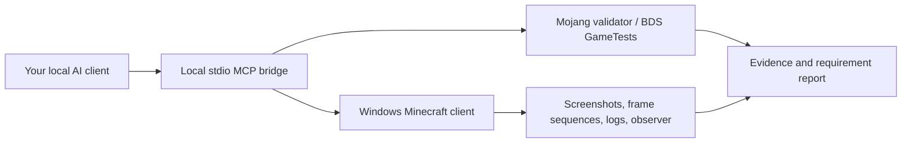

# MCBE Addon Tester

**A local Windows testing lab that an AI can operate against the real Minecraft Bedrock client.**

It gives an MCP-compatible AI screenshots, keyboard/mouse control, animation frame capture,
content logs, optional in-game state observations, repeatable scenarios, visual comparisons,
and evidence-backed HTML/JSON reports. Add-ons are installed into newly generated test-world
exports; the program does not edit your existing worlds or global development packs.

**Status: initial implementation, version 0.1.0.** Portable logic and the MCP protocol are
covered by automated tests. Native Windows API discovery is checked in Windows CI. Actual
Minecraft input, rendering, world import and observer behavior still require the live
acceptance run described in [docs/ACCEPTANCE.md](docs/ACCEPTANCE.md). Neither a 95% bug-detection
rate nor exhaustive correctness has been demonstrated. This is a test tool, not a certification.

## What this does

| Area | Implemented mechanism | What a pass means |
| --- | --- | --- |
| Files and packaging | Bounded `.mcaddon` / `.mcpack` / ZIP or folder inspection; optional Mojang validator | The checks actually applied succeeded |
| Game controls | Windows keyboard, mouse buttons/holds, relative camera movement, scrolling, text entry | AI or state assertions must verify the game's response |
| Graphics | Actual game screenshots, frame sequences, approved-reference comparisons and diff images | The reviewed scene or comparison passed; screenshots cannot prove every animation/state |
| Menus | AI sees and operates the real game UI | The specific inventory, form, settings or menu workflow was exercised |
| Gameplay | Optional observer with player health, inventory, nearby entities, events and block queries | A declared state assertion matched the current run after a checkpoint tick |
| Persistence | AI saves/quits/reopens the disposable world using the real UI | The declared saved state survived that lifecycle |
| Server tests | Adapter to `@bedrock-core/bds-runner` on a pinned official BDS build | Explicitly registered GameTests passed; no tests is never success |
| Reporting | Frozen requirements, hashed evidence, action audit, separate AI/automated verdicts | Passed **for the defined scope**; untested requirements stay untested |
| Accuracy measurement | Labelled benchmark report, including missed/blocked cases and false alarms | Detection rate on that particular labelled benchmark |

There is no bundled AI model or API key. Your local AI client supplies reasoning and vision.
The MCP tools supply controlled access to the actual game. This version has **no automatic
audio capture, GPU frame-time profiler, controller/touch input driver, multi-client scheduler,
or console/device farm**. Those checks need additional tools or human evidence; leave them
untested rather than treating keyboard/mouse Windows results as proof for every device.



## Windows 10 setup

1. Install Minecraft **Bedrock for Windows**, sign in normally, and update the retail game.
2. Install **64-bit Python 3.12**. Download this repository (Code → Download ZIP) and extract it.
3. Double-click **`Install-Windows.cmd`**. It creates a local Python environment and installs
   this package plus the MCP bridge. No administrator account is needed for the tester.
4. In Minecraft, enable **Settings → Creator → Content Log File**. Set the log level to Info
   or Verbose. Keep the game visible, unobstructed and unlocked while the AI operates it.
   Start with windowed mode so screenshot/input calibration is easy.
5. Make a **new disposable base world with no add-ons**, the intended difficulty/game mode,
   and cheats enabled if your tests use commands. Save, quit and export it as `base.mcworld`.
   For production acceptance, also use a template with the exact intended cheats/experiments.
   An AI using this bridge can perform these UI steps, but confirm the world it is operating.

The test necessarily loads the add-on into Minecraft. It does so in a separate test world
before you use the add-on in your own world. A clean `.mcworld` template is currently required;
the program does not fabricate a LevelDB world or assume an empty folder is a valid world.

## Connect an AI

Use a local AI client that supports **stdio MCP and image tools**. Add this server to its MCP
configuration, replacing the example paths with the folder where you extracted this repo:

```json
{
  "mcpServers": {
    "mcbe-addon-tester": {
      "command": "C:\\MCBE-Addon-Tester\\.venv\\Scripts\\python.exe",
      "args": ["-m", "mcbe_tester.mcp_server"],
      "env": {"MCBE_LAB_ROOT": "C:\\MCBE-Addon-Tester\\.mcbe-lab"}
    }
  }
}
```

Configuration wrappers differ between AI clients. The underlying command is always the
venv's Python executable with `-m mcbe_tester.mcp_server`. `Start-AI-Bridge.cmd` runs the same
server for a client that accepts a launcher script; it is not a conversational chat window.

**Connecting GitHub to ChatGPT alone does not grant access to your PC or start this bridge.**
The server must run on your Windows PC, and the AI client must connect to it locally. A
GitHub/cloud coding agent can edit this repository and run portable tests, but cannot see
your Minecraft window through GitHub. Do not expose this stdio bridge as a public web server.

Give the AI this task, with actual paths and your add-on's intended behavior:

> Use MCBE Addon Tester on my Windows Bedrock installation. Read the README and
> docs/AI-WORKFLOW.md. My add-on is at [path], my clean test-world template is at [path],
> and these are its intended features: [description]. Run doctor, make an explicit test
> plan with the observed game build, create a disposable test world, and test every
> requirement with real controls plus screenshots/logs/state assertions. Test graphics
> and menus in the real client. Report failures and anything you could not test.
> Do not modify my normal worlds or invent pass results.

**Stop input:** hold **F8** during an action, or run `STOP.cmd`. Input holds check for stop
and foreground focus repeatedly and release keys/buttons on interruption. The stop file
remains latched; manually remove `.mcbe-lab\STOP` when you want to resume. When using a custom
`MCBE_LAB_ROOT`, create `STOP` in that root (the convenience `.cmd` targets the repo's default).
Do not type/move the mouse simultaneously with the agent.

## First run from PowerShell

Open PowerShell in the repository. The CLI is also usable without an AI:

```powershell
.\.venv\Scripts\mcbe-test.exe doctor
.\.venv\Scripts\mcbe-test.exe versions
```

Open Minecraft first. Copy its `file_version` from `doctor` into
`examples/plan.json` → `target.file_version`. Add requirements for **your** intended behavior;
the supplied plan only covers the included demo block. Record graphics mode, GUI scale,
resolution, language, input settings, difficulty and experiments in the plan's `target`.
`versions` queries official stable/preview **server** downloads. It does not equate a Windows
package/file version with a BDS build or certify that the installed client is the latest.

```powershell
.\.venv\Scripts\mcbe-test.exe start examples\plan.json examples\demo-addon
.\.venv\Scripts\mcbe-test.exe prepare-world C:\Tests\base.mcworld
.\.venv\Scripts\mcbe-test.exe open-world
.\.venv\Scripts\mcbe-test.exe bind
```

Verify the generated **Addon Lab [run ID]** world name in the Minecraft UI and open it.
For the demo fixture, give yourself `lab:test_block` using `/give @s lab:test_block 16` in
that test world. The AI can then operate the real inventory, place/break the block, inspect
its faces and save/reopen the world. The demo's static validation does not establish in-game behavior.

```powershell
.\.venv\Scripts\mcbe-test.exe capture --name first-look
.\.venv\Scripts\mcbe-test.exe run examples\inventory-scenario.json
.\.venv\Scripts\mcbe-test.exe logs
.\.venv\Scripts\mcbe-test.exe report
```

`report` creates `report.html` and `report.json` under the run folder printed by `start`.
An incomplete report intentionally exits with code 1. Capturing a screenshot or finishing
a scenario's actions **does not** mark requirements passed. Use the AI's `record_result`
tool or `mcbe-test record` with the actual observation and evidence IDs.

CLI exit codes: `0` operation completed/passed, `1` failed or incomplete check/report,
`2` setup/tool error. Read structured status and scope as well; `doctor` can complete while
reporting that no game is available. `--root PATH` precedes the subcommand when overriding
the artifacts folder. One agent/CLI operation at a time per root is supported.

## Optional state observer

Prepare an additional test world with `--api-version` set to an exact **stable**
`@minecraft/server` version supported by your installed game:

```powershell
.\.venv\Scripts\mcbe-test.exe prepare-world C:\Tests\base.mcworld --api-version 2.0.0
```

`2.0.0` is an example, not a claim about the newest API. The original add-on bytes and UUIDs
are preserved. A separate development-only observer pack emits run-tagged JSON to the
content log. Read a snapshot, keep its tick, perform an action, and assert state after that
tick. For example, `players.0.items`, `players.0.health`, or the `block.typeId` observation.
The `assert_state` tool takes `kind: "block"` and `field: "typeId"` for a block assertion.

For block queries, issue this command in the test world with a fresh `nonce` and the real coordinates:

```text
/scriptevent bedrocklab:probe {"nonce":"place-1","dimension":"overworld","location":{"x":0,"y":64,"z":0}}
```

The observer samples once per 20 game ticks and nearby entities within 32 blocks (capped at
64 per player); it is not exhaustive instrumentation. Unsupported events are logged. No
observer output means a blocked state check, not success. Reopening a world may reset tick
numbers: obtain a new checkpoint after each load. The observer affects the tested environment,
so repeat final acceptance in the **uninstrumented** world with intended settings.

## Optional official validation and headless engine tests

Install Node.js 22+ and the pinned adapters:

```powershell
npm --prefix tools ci
.\.venv\Scripts\mcbe-test.exe external mct examples\demo-addon
```

Mojang Creator Tools is the full static validator; the built-in inventory check is deliberately
limited. The adapter retains raw output and incorporates failed or blocked external checks
into the run report. A clean static check never passes gameplay requirements.

For GameTests, supply built packs including a **separate authored GameTest behavior pack**,
an exact BDS build from `versions`, a test tag, and an expected test count:

```text
mcbe-test external bds C:\Tests\built-packs --tag my-suite --expected-tests 12 --bds-version EXACT_BUILD
```

The server comes from Mojang via the external runner; no Minecraft binary is redistributed.
Review its download terms before use. GameTests enable Beta APIs in an isolated server world.
Our adapter uses Normal difficulty and restores the standard watchdog settings instead of
silently taking the runner's Peaceful/relaxed-watchdog defaults. Override/expand this adapter
for a test matrix matching your deployment. BDS cannot render client menus or textures.

## Visual references and measured coverage

`approve_visual_reference` stores a reviewed baseline with its hash, game build and review
reason. `compare_visual` creates a pixel difference image and checks a configurable changed-pixel
fraction against a reference from an **earlier reviewed run** with matching recorded settings.
It does not let a run approve itself by comparing its own newly approved screenshot, and
it never resizes mismatched screenshots to force a pass. Fix the camera, lighting,
resolution and GUI scale, and use a bounded region when unrelated animation would add noise.
AI reference approval is recorded as AI review. A pixel match cannot establish an unknown
design's correctness, and a different pixel is not automatically a game bug.

The report separates **requirements assessed**, **requirements passed**, and **AI-reviewed
passes**. A 95% coverage number is about the finite test plan, not a 95% chance that the add-on
is correct. [docs/RESEARCH.md](docs/RESEARCH.md) explains how to evaluate a meaningful 95%
bug-detection target with independently labelled broken and working packs.

## Development

```text
python -m venv .venv
python -m pip install -e ".[ai,dev]"
python -m unittest discover -v
ruff check src tests
ruff format --check src tests
```

Use the virtual environment's Python/pip (or activate it) for the commands after creation.
CI runs on Linux and Windows. Test doubles validate the controller protocol, not Minecraft
behavior. Runtime worlds, logs, screenshots and local dependencies are gitignored and are
not uploaded automatically. [Research](docs/RESEARCH.md) · [AI workflow](docs/AI-WORKFLOW.md)
· [Live acceptance](docs/ACCEPTANCE.md) · [Limitations](docs/LIMITATIONS.md).
